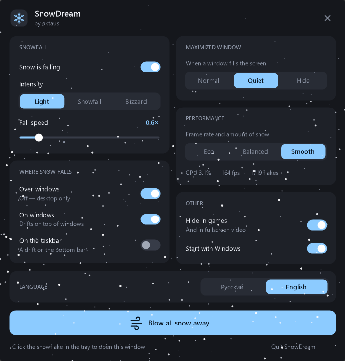

# ❄ SnowDream

**Realistic snow for your Windows desktop — with drifts that pile up on your windows.**

*by øktaus*

[English](#english) · [Русский](#русский)

<p align="center">
  
</p>

---

## English

SnowDream makes it snow right on top of your desktop. Flakes drift with the wind, land on the top edges of your open windows and slowly build up snowdrifts. Close or minimize a window and its snowdrift falls down — and can land on the windows below.

### Features

- **Real snow physics.** Snow piles up on the visible top edges of windows, slides off the edges, follows the rounded corners of Windows 11 windows, and covers the taskbar and the bottom of the screen.
- **Windows interact with snow.** Close or minimize a window and its drift collapses. Jerk a window sharply and the snow flies off by inertia; drag it gently and the snow stays.
- **Blow all snow away.** A gust of wind sweeps across the screen from left to right and lifts every drift into the air. After ~5 seconds it calms down and the snow falls straight again.
- **Doesn't get in the way.** Click-through overlay; snow gets quiet in maximized windows and hides in games and fullscreen video.
- **Lightweight.** ~1–3% CPU, ~50 MB RAM, a single ~60 KB `.exe` with no dependencies.
- **Settings:** intensity (light / snowfall / blizzard), fall speed, snow over windows or desktop only, drifts on windows and the taskbar, behaviour in maximized windows, performance mode (30 fps / 60 fps / monitor refresh rate), start with Windows, Russian / English.

### Download

Grab `SnowDream.exe` from the [Releases](../../releases) page and run it. No installation needed.

> Windows SmartScreen may warn you because the app isn't signed. Click **More info → Run anyway**.

### Usage

- **Left-click** the snowflake in the tray to open the settings.
- **Right-click** it for a quick menu: settings, stop snowfall, blow the snow away, quit.
- `SnowDream.exe --blow` blows the snow away in the running app (handy for a shortcut).
- If you don't see the snowflake, Windows 11 may have hidden it under the **^** arrow next to the clock — drag it onto the taskbar.

### Requirements

Windows 10 or 11 (x64) with .NET Framework 4.x, which ships with Windows.

### Build from source

No SDK required: the project is built with the C# compiler that comes with Windows.

```bat
build.bat
```

The result is `SnowDream.exe` in the same folder.

| File | What's inside |
| --- | --- |
| `Snow.cs` | overlay window, snow physics, window tracking, tray |
| `Ui.cs` | settings window with custom-drawn controls |
| `build.bat` | build script |

---

## Русский

SnowDream запускает снег прямо поверх рабочего стола. Снежинки летят с ветром, ложатся на верхние края открытых окон и постепенно наметают сугробы. Закроешь или свернёшь окно, и его сугроб рухнет вниз, а может и засыпать окна под ним.

### Возможности

- **Настоящая физика снега.** Снег копится на видимых краях окон, сползает с краёв, повторяет скруглённые углы окон Windows 11, засыпает панель задач и низ экрана.
- **Окна взаимодействуют со снегом.** Закрыл или свернул окно, и сугроб обрушивается. Резко дёрнул окно, и снег слетает по инерции, а при плавном перетаскивании держится.
- **«Сдуть весь снег».** Порыв ветра проносится по экрану слева направо и поднимает в воздух все сугробы. Секунд через 5 он стихает, и снег снова падает вертикально.
- **Не мешает.** Клики проходят сквозь снег. В развёрнутых окнах снег становится тихим, а в играх и полноэкранном видео прячется.
- **Лёгкий.** Около 1–3% процессора, ~50 МБ памяти, один `.exe` на ~60 КБ без зависимостей.
- **Настройки:** сила снегопада (лёгкий / снегопад / метель), скорость падения, снег поверх окон или только на рабочем столе, сугробы на окнах и панели задач, поведение в развёрнутых окнах, режим нагрузки (30 кадр/с / 60 кадр/с / частота монитора), автозапуск, русский / английский.

### Скачать

Скачай `SnowDream.exe` со страницы [Releases](../../releases) и запусти. Установка не нужна.

> Windows SmartScreen может предупредить, что приложение не подписано. Нажми **Подробнее → Выполнить в любом случае**.

### Как пользоваться

- **Левый клик** по снежинке в трее открывает настройки.
- **Правый клик** открывает быстрое меню: настройки, остановить снегопад, сдуть снег, выход.
- `SnowDream.exe --blow` сдувает снег у запущенной программы (удобно повесить на ярлык).
- Если снежинки не видно, Windows 11 могла спрятать её под стрелочку **^** у часов. Перетащи её на панель задач.

### Требования

Windows 10 или 11 (x64) с .NET Framework 4.x, он уже есть в Windows.

### Сборка из исходников

SDK не нужен: проект собирается компилятором C#, который встроен в Windows.

```bat
build.bat
```

Готовый `SnowDream.exe` появится в той же папке.

---

MIT License · © 2026 øktaus
